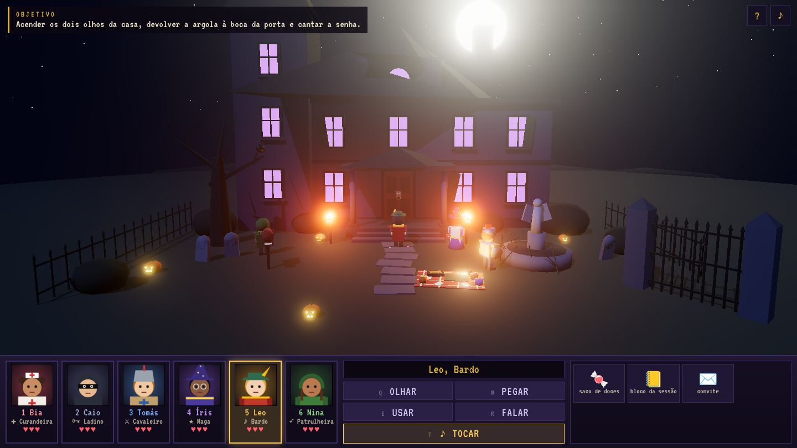
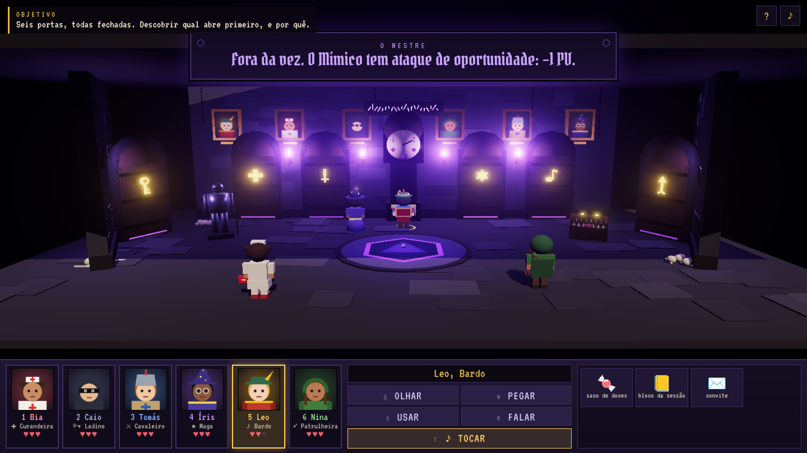
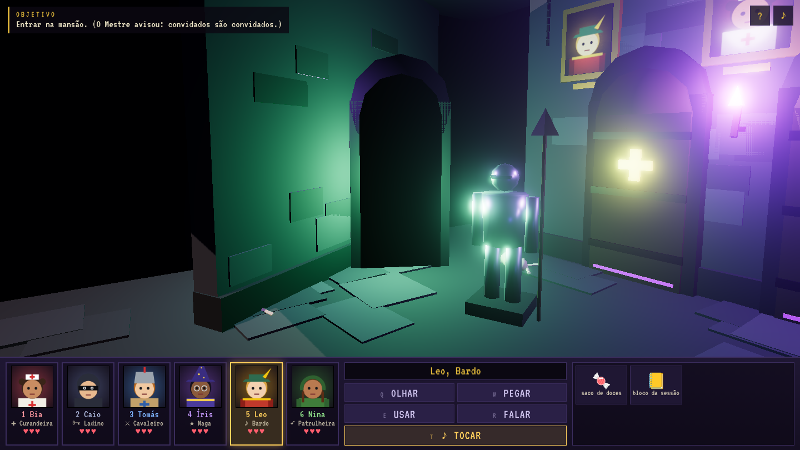

# Noite Crítica

**Jogar agora: https://noite-critica.vercel.app**

**Um point-and-click 2.5D em capítulos.** Halloween de 1987: seis crianças jogam um RPG de mesa
achado na varanda de uma mansão abandonada. O dado de osso tira 1. A mansão vira a masmorra, a casa
é o Mestre, e cada fantasia vira uma classe de verdade.

Jogo autoral. Inspirado no espírito das aventuras de mansão dos anos 80, das turmas de bicicleta
contra o sobrenatural e do RPG de mesa clássico; nomes, personagens, arte, texto e código originais.



| O Hall, depois que o Mestre "arruma o cenário" | A porta de quem age primeiro |
|---|---|
|  |  |

## Estado atual — v0.1 (Capítulo 1: O Limiar)

| Área | Estado |
|---|---|
| **Capítulo 1 jogável na web** (intro, jardim, hall, final) | Pronto. Testado de ponta a ponta por script (`npm test`) e por clique real (`tools/mouse.mjs`). |
| História, cutscenes, puzzles | Prontos e documentados em `docs/`. |
| Modelos 3D (6 crianças, 2 cenários com estado casa/masmorra) | Gerados por script no Blender 5.3 → GLB. Qualidade de blockout estilizado. |
| Áudio | Sintetizado em tempo real (WebAudio). Sem arquivos de áudio. |
| **Projeto Unity** | **Scaffold C# não compilado.** Porta do intérprete de regras; falta abrir no editor (ver `unity/README.md`). |
| Save, mobile/toque, localização | Não existem ainda (ver roadmap). |
| Publicação na Vercel | **No ar: https://noite-critica.vercel.app** (deploy via CLI; falta conectar o Git para publicar a cada push). |

### Por que web primeiro, se o alvo é Unity + Blender?

A v0.1 foi produzida num ambiente sem Unity Editor. Para ter algo jogável e publicável já, a fatia
vertical roda em Three.js. O Blender é usado de verdade (pipeline headless) e nada se perde na
migração: os **mesmos GLB** e o **mesmo `content/chapter1.json`** alimentam o Unity. Detalhes em
[`docs/TECH.md`](docs/TECH.md).

## Jogar localmente

```bash
npm install
npm run dev
```

Abra `http://localhost:5173`. Mouse para tudo; botão direito olha; `1-6` troca de criança;
`Q W E R T` são os verbos (T é o verbo de classe); `H` pede dica; `Esc` pula cutscene; `M` som.
Em máquina fraca: `http://localhost:5173/?fx=0`.

## O jogo em 30 segundos

- **Seis crianças, seis classes, seis verbos exclusivos**: Bia (Curandeira, *Curar*), Caio (Ladino,
  *Gazua*), Tomás (Cavaleiro, *Força*), Íris (Maga, *Magia*), Leo (Bardo, *Tocar*), Nina
  (Patrulheira, *Rastrear*).
- **A casa é o Mestre**: todo puzzle é uma regra de mesa escrita em cena. Errar custa PV.
- **Capítulo 1**: ser *convidado* a entrar (um uso de cada classe no jardim) e descobrir, no hall,
  **qual das seis portas lacradas abre primeiro e por quê** (resposta: iniciativa).

## Documentação (por departamento)

| Documento | Conteúdo |
|---|---|
| [`docs/GDD.md`](docs/GDD.md) | Game design: pilares, elenco, mecânicas, estrutura da temporada, perguntas em aberto |
| [`docs/NARRATIVA.md`](docs/NARRATIVA.md) | Bíblia do mundo, mistério da temporada, roteiro das 3 cutscenes, guia de voz |
| [`docs/PUZZLES.md`](docs/PUZZLES.md) | Grafos de dependência, matriz de classes, dead-ends, roteiro de solução |
| [`docs/TECH.md`](docs/TECH.md) | Arquitetura, contrato de nomes Blender→engine, esquema do JSON, build e deploy |
| [`docs/PRODUCAO.md`](docs/PRODUCAO.md) | Departamentos, marcos, backlog, pipeline de conteúdo, riscos |
| [`unity/README.md`](unity/README.md) | Como montar o projeto Unity a partir do scaffold |

## Estrutura do repositório

```
content/chapter1.json     história, regras, cutscenes (fonte única; web e Unity leem daqui)
blender/build_assets.py   pipeline de assets (Blender headless → public/assets/*.glb)
public/assets/            GLB gerados (versionados para o deploy não depender do Blender)
src/                      build web: main.js (motor), audio.js, portraits.js, style.css
tools/playthrough.mjs     teste: joga o capítulo inteiro num Chromium headless
tools/mouse.mjs           teste: hover, cliques, verbos e inventário por mouse real
unity/                    scaffold C# do intérprete para Unity 6 (não compilado)
docs/                     GDD, narrativa, puzzles, técnica, produção
```

## Comandos

```bash
npm run dev
```

```bash
npm run build
```

```bash
pip install bpy && npm run assets
```

```bash
npm run build && npx vite preview --port 4173
```

```bash
npm test            # capítulo 1 inteiro
npm run test:ch2    # capítulo 2 (protótipo), as 10 duplas
```

(Os testes precisam do preview rodando em outro terminal; `npm install` já traz o Playwright, mas o
Chromium vem de `npx playwright install chromium`. Em máquina carregada use `FX=0 npm test`.)

O protótipo do **Capítulo 2** abre em `/?ch=2` (local ou na Vercel).

## Publicar (Vercel)

Projeto Vite padrão: a Vercel detecta sozinha (`npm run build` → `dist/`).

```bash
git remote add origin git@github.com:ardsilva/noite-critica.git
```

```bash
git push -u origin main
```

Depois, na Vercel: **Add New → Project → importar `noite-critica`** (preset Vite, sem variáveis de
ambiente). Cada push em `main` publica depois de `vercel git connect` (ou da integração GitHub da Vercel).

## Roadmap resumido

1. **M1 — Unity de pé**: abrir o scaffold no Unity 6, implementar `IGameServices`, jogar o cap. 1.
2. **Save** na build web; **toque** para mobile.
3. **M2 — Passe de arte**: modelagem manual sobre o blockout, rig e clips.
4. **M3 — Capítulo 2, "A Vez do Ladino"**: o porão, mecânica de dois lados. **Protótipo sem arte jogável** (`/?ch=2`); faltam arte (Blender), cutscenes de autor, limite do monta-carga e porte para o Unity.
5. Infra de produto: Supabase (saves/contas), Stripe (capítulos), EN.

Plano completo, backlog e riscos em [`docs/PRODUCAO.md`](docs/PRODUCAO.md).

## Como continuar (para a próxima sessão)

- **Conteúdo novo** = editar `content/chapterN.json` + nomear objetos no Blender (`hs_*`, `st_*`).
  Não precisa mexer no motor. Passo a passo em `docs/PRODUCAO.md` §4.
- **Antes de modelar o capítulo 2**, responder às 4 perguntas de `docs/GDD.md` §11.
- **Regra de ouro**: lógica de puzzle só no JSON; `npm test` é a referência de comportamento.

## Registro de mudanças

- **v0.2.0-proto** — Protótipo do Capítulo 2: equipe de 3 de 6 (Caio + 2 apoios), duas salas ativas (hall do
  tubo e porão), tubo e monta-carga, 4 salas em blockout, `test:ch2` com as 10 duplas. O motor passou a aceitar
  `?ch=2`, `goto`/`view`/`ui team`, `team:` e `who` em lista. Capítulo 1 inalterado (testes passam).
- **v0.1.0** — Fatia vertical do Capítulo 1: 3 cutscenes, 2 salas, 6 classes, 2 minijogos (senha
  cantada, relógio da iniciativa), sistema de PV/cura, dicas contextuais, pipeline Blender,
  scaffold Unity, documentação de produção.
