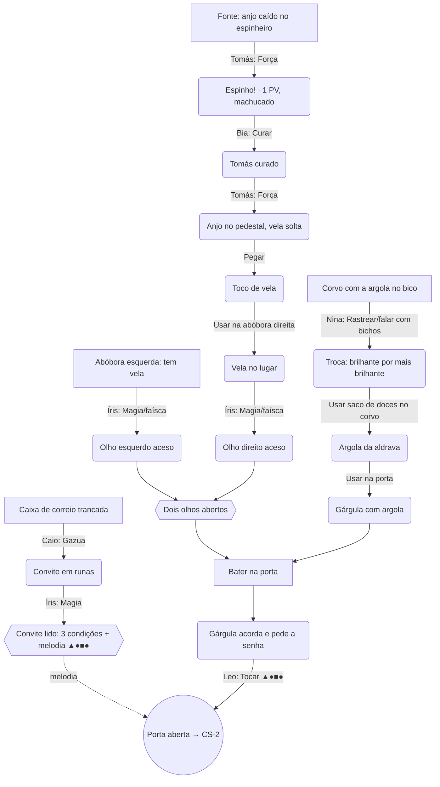
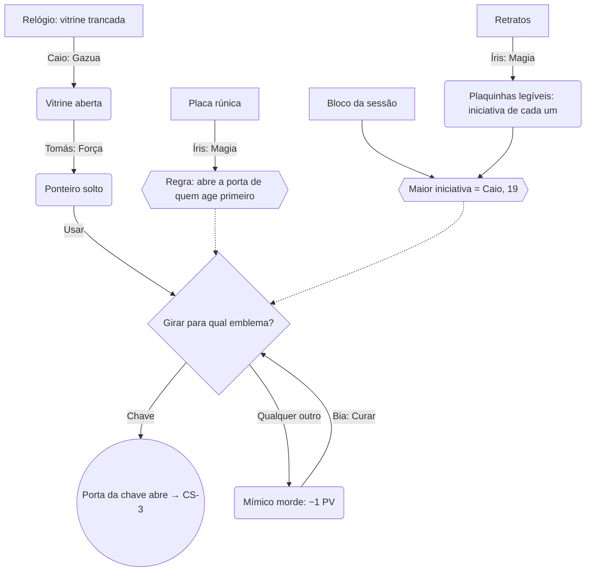

# Noite Crítica — Design de puzzles do Capítulo 1

> Dono: Level/Puzzle Design · Implementação: `rooms.*.hotspots` em
> [`content/chapter1.json`](../content/chapter1.json) · Teste automático da solução: `npm test`

## Princípios

1. **Toda tranca é uma regra, e toda regra está escrita em cena.** O jogador nunca adivinha: lê.
2. **Um verbo de classe por passo.** O capítulo 1 é o tutorial das seis classes; cada uma é
   indispensável pelo menos uma vez em cada fase... ou quase (ver matriz).
3. **O "quase" tem resposta.** Usar a classe errada devolve uma fala própria que aponta para a certa.
4. **Errar custa PV, nunca o jogo.** Não existe estado sem saída (testado na matriz de dead-ends).
5. **Dica na voz dos amigos.** *Falar* com um colega sempre devolve o próximo passo.

## Fase 1 — O Jardim: "convidados são convidados"

**Objetivo:** entrar na mansão. **Regra do Mestre:** a porta não tem fechadura; só entra convidado.
O *convite* (na caixa de correio) lista três condições: **acender os dois olhos**, **devolver a argola
à boca da porta**, **cantar a senha**.

### Grafo de dependências

### Matriz de classes (Fase 1)

| Passo | Bia | Caio | Tomás | Íris | Leo | Nina |
|---|:-:|:-:|:-:|:-:|:-:|:-:|
| Abrir a caixa de correio | | **X** | quase | quase | | |
| Ler o convite | | | | **X** | | |
| Acender as abóboras | | | | **X** | | |
| Levantar o anjo | | quase | **X** | | | |
| Curar o Tomás | **X** | | | | | |
| Negociar com o corvo | | | quase | | quase | **X** |
| Cantar a senha | | | | | **X** | |

"quase" = existe fala específica de tentativa com a classe errada.

### Notas de design

- **A armadilha de espinhos é uma falha forçada.** O Tomás sempre se machuca na primeira tentativa
  (tirou 3 de iniciativa: o dado dele é azarado, piada recorrente). Serve para ensinar PV, a condição
  *machucado* e a Bia, num lugar sem risco.
- **O convite pode ser lido a qualquer momento**, mas nada exige a ordem: o jogador curioso pode
  acender a abóbora esquerda antes de saber por quê. A senha só é *pedida* depois de olhos + argola.
- **A melodia é informação, não reflexo.** Quatro símbolos coloridos, sem tempo. Errar não custa PV
  (a gárgula só reclama). Custo de erro cresce no hall.
- **Arenque vermelho honesto:** o portão. Todo verbo nele responde reforçando a Regra 2.

## Fase 2 — O Hall: "qual porta abre, e por quê?"

**Situação:** seis portas de ferro lacradas, cada uma com o emblema de uma classe. Nenhuma tem
fechadura (*"isso não é uma porta trancada, é uma regra"*). A regra está na placa rúnica:

> SEIS PORTAS, SEIS VEZES. ABRE-SE A PORTA DE QUEM AGE PRIMEIRO.
> O RELÓGIO MARCA A VEZ. QUEM JOGA FORA DA VEZ PAGA EM PV.

**A resposta:** "quem age primeiro" é **iniciativa**. A maior iniciativa rolada na intro foi a do
**Caio (19)**. Logo, abre a **porta da chave**. O jogador prova que entendeu girando o ponteiro do
relógio para o emblema da chave.

### Três fontes para a mesma resposta (redundância proposital)

| Fonte | Como se obtém | Para que tipo de jogador |
|---|---|---|
| **Bloco da sessão** (inventário) | Já está com o grupo desde a intro | O que mexe no inventário |
| **Plaquinhas dos retratos** | Íris lê as runas; depois todos leem "INICIATIVA n" | O que explora o cenário |
| **Rastros** | Nina rastreia o mosaico: marca de arrasto só na porta da chave | O que testa todas as classes |
| (memória) | Assistiu à intro | O atento |

### Grafo de dependências

### Notas de design

- **O relógio usa duas classes antes da decisão** (Gazua + Força) para que a escolha final seja o
  clímax do puzzle, e não o primeiro clique.
- **Custo de erro real, mas limitado:** o Mímico (o baú que era só um baú na versão *casa*) morde
  quem gira errado. Com 1 PV a criança se recusa a tocar no relógio e chama a Bia: impossível travar.
- **A Bia pode se curar**, então o pior caso (todos a 1 PV) sempre tem saída.
- **Coerência com a temporada:** a ordem das portas é a ordem de iniciativa, e isso vira a estrutura
  dos capítulos 2 a 7. O puzzle do hall ensina a regra que organiza o jogo inteiro.
- **Tomás tirou 3** e portanto é o último: a sala de armas é o capítulo 7. O cavaleiro "que vai na
  frente" passa a temporada inteira esperando a vez. Arco de personagem embutido na mecânica.

## Matriz de dead-ends (verificada)

| Risco | Mitigação |
|---|---|
| Gastar o saco de doces antes da hora | Doces não são consumidos; o corvo recusa antes da conversa. |
| Ficar sem PV | Mínimo 1 PV; ações perigosas bloqueadas com 1 PV; cura ilimitada. |
| Usar a vela no lugar errado | Só a abóbora direita aceita. |
| Errar a melodia | Sem custo; pode tentar de novo; "Desistir" fecha a UI. |
| Pular a cutscene e perder a iniciativa | Bloco da sessão no inventário + retratos + rastros. |

## Roteiro de solução (o que `npm test` executa)

1. Caio → **Gazua** na caixa de correio → convite.
2. Íris → **Magia** no convite (inventário).
3. Íris → **Magia** na abóbora esquerda.
4. Tomás → **Força** na fonte (espinho, −1 PV). Bia → **Curar** Tomás. Tomás → **Força** de novo.
5. Qualquer um → **Pegar** a vela na fonte → **Usar** vela na abóbora direita. Íris → **Magia**.
6. Nina → **Rastrear** o corvo. Qualquer um → **Usar** saco de doces no corvo → argola.
7. **Usar** argola na porta. **Usar** a porta (bater). Leo → **Tocar** → ▲ ● ■ ●.
8. *(hall)* Íris → **Magia** na placa. Caio → **Gazua** no relógio. Tomás → **Força** no relógio.
9. **Usar** o relógio → emblema da **chave**.
