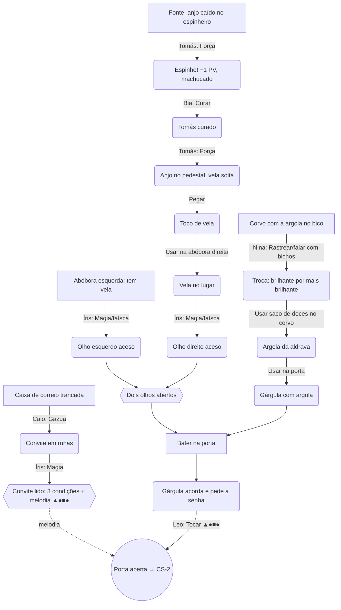
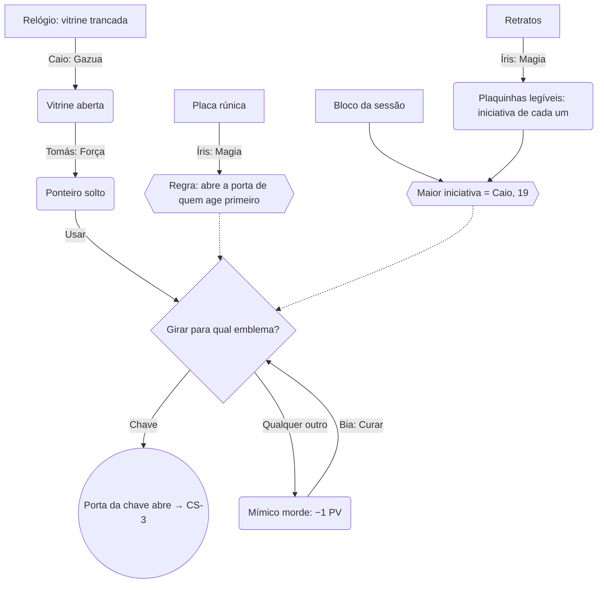
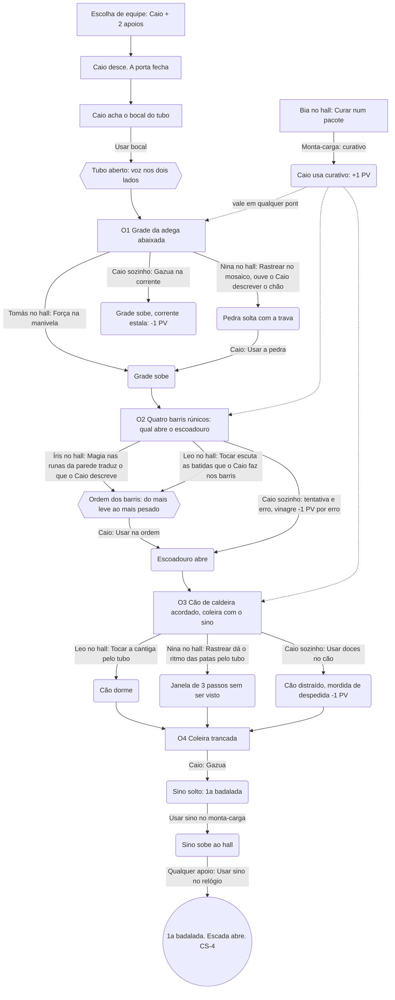

# Noite Crítica — Design de puzzles do Capítulo 1

> Dono: Level/Puzzle Design · Implementação: `rooms.*.hotspots` em
> [`content/chapter1.json`](../content/chapter1.json) · Teste automático da solução: `npm test`

## Princípios

1. **Toda tranca é uma regra, e toda regra está escrita em cena.** O jogador nunca adivinha: lê.
2. **Um verbo de classe por passo.** O capítulo 1 é o tutorial das seis classes; cada uma é
   indispensável pelo menos uma vez em cada fase... ou quase (ver matriz).
3. **O "quase" tem resposta.** Usar a classe errada devolve uma fala própria que aponta para a certa.
4. **Errar custa PV, nunca o jogo.** Não existe estado sem saída (testado na matriz de dead-ends).
5. **Dica na voz dos amigos.** *Falar* com um colega sempre devolve o próximo passo.

## Fase 1 — O Jardim: "convidados são convidados"

**Objetivo:** entrar na mansão. **Regra do Mestre:** a porta não tem fechadura; só entra convidado.
O *convite* (na caixa de correio) lista três condições: **acender os dois olhos**, **devolver a argola
à boca da porta**, **cantar a senha**.

### Grafo de dependências

### Matriz de classes (Fase 1)

| Passo | Bia | Caio | Tomás | Íris | Leo | Nina |
|---|:-:|:-:|:-:|:-:|:-:|:-:|
| Abrir a caixa de correio | | **X** | quase | quase | | |
| Ler o convite | | | | **X** | | |
| Acender as abóboras | | | | **X** | | |
| Levantar o anjo | | quase | **X** | | | |
| Curar o Tomás | **X** | | | | | |
| Negociar com o corvo | | | quase | | quase | **X** |
| Cantar a senha | | | | | **X** | |

"quase" = existe fala específica de tentativa com a classe errada.

### Notas de design

- **A armadilha de espinhos é uma falha forçada.** O Tomás sempre se machuca na primeira tentativa
  (tirou 3 de iniciativa: o dado dele é azarado, piada recorrente). Serve para ensinar PV, a condição
  *machucado* e a Bia, num lugar sem risco.
- **O convite pode ser lido a qualquer momento**, mas nada exige a ordem: o jogador curioso pode
  acender a abóbora esquerda antes de saber por quê. A senha só é *pedida* depois de olhos + argola.
- **A melodia é informação, não reflexo.** Quatro símbolos coloridos, sem tempo. Errar não custa PV
  (a gárgula só reclama). Custo de erro cresce no hall.
- **Arenque vermelho honesto:** o portão. Todo verbo nele responde reforçando a Regra 2.

## Fase 2 — O Hall: "qual porta abre, e por quê?"

**Situação:** seis portas de ferro lacradas, cada uma com o emblema de uma classe. Nenhuma tem
fechadura (*"isso não é uma porta trancada, é uma regra"*). A regra está na placa rúnica:

> SEIS PORTAS, SEIS VEZES. ABRE-SE A PORTA DE QUEM AGE PRIMEIRO.
> O RELÓGIO MARCA A VEZ. QUEM JOGA FORA DA VEZ PAGA EM PV.

**A resposta:** "quem age primeiro" é **iniciativa**. A maior iniciativa rolada na intro foi a do
**Caio (19)**. Logo, abre a **porta da chave**. O jogador prova que entendeu girando o ponteiro do
relógio para o emblema da chave.

### Três fontes para a mesma resposta (redundância proposital)

| Fonte | Como se obtém | Para que tipo de jogador |
|---|---|---|
| **Bloco da sessão** (inventário) | Já está com o grupo desde a intro | O que mexe no inventário |
| **Plaquinhas dos retratos** | Íris lê as runas; depois todos leem "INICIATIVA n" | O que explora o cenário |
| **Rastros** | Nina rastreia o mosaico: marca de arrasto só na porta da chave | O que testa todas as classes |
| (memória) | Assistiu à intro | O atento |

### Grafo de dependências

### Notas de design

- **O relógio usa duas classes antes da decisão** (Gazua + Força) para que a escolha final seja o
  clímax do puzzle, e não o primeiro clique.
- **Custo de erro real, mas limitado:** o Mímico (o baú que era só um baú na versão *casa*) morde
  quem gira errado. Com 1 PV a criança se recusa a tocar no relógio e chama a Bia: impossível travar.
- **A Bia pode se curar**, então o pior caso (todos a 1 PV) sempre tem saída.
- **Coerência com a temporada:** a ordem das portas é a ordem de iniciativa, e isso vira a estrutura
  dos capítulos 2 a 7. O puzzle do hall ensina a regra que organiza o jogo inteiro.
- **Tomás tirou 3** e portanto é o último: a sala de armas é o capítulo 7. O cavaleiro "que vai na
  frente" passa a temporada inteira esperando a vez. Arco de personagem embutido na mecânica.

## Matriz de dead-ends (verificada)

| Risco | Mitigação |
|---|---|
| Gastar o saco de doces antes da hora | Doces não são consumidos; o corvo recusa antes da conversa. |
| Ficar sem PV | Mínimo 1 PV; ações perigosas bloqueadas com 1 PV; cura ilimitada. |
| Usar a vela no lugar errado | Só a abóbora direita aceita. |
| Errar a melodia | Sem custo; pode tentar de novo; "Desistir" fecha a UI. |
| Pular a cutscene e perder a iniciativa | Bloco da sessão no inventário + retratos + rastros. |

## Roteiro de solução (o que `npm test` executa)

1. Caio → **Gazua** na caixa de correio → convite.
2. Íris → **Magia** no convite (inventário).
3. Íris → **Magia** na abóbora esquerda.
4. Tomás → **Força** na fonte (espinho, −1 PV). Bia → **Curar** Tomás. Tomás → **Força** de novo.
5. Qualquer um → **Pegar** a vela na fonte → **Usar** vela na abóbora direita. Íris → **Magia**.
6. Nina → **Rastrear** o corvo. Qualquer um → **Usar** saco de doces no corvo → argola.
7. **Usar** argola na porta. **Usar** a porta (bater). Leo → **Tocar** → ▲ ● ■ ●.
8. *(hall)* Íris → **Magia** na placa. Caio → **Gazua** no relógio. Tomás → **Força** no relógio.
9. **Usar** o relógio → emblema da **chave**.

---

# Capítulo 2 — "A Vez do Ladino" (design, ainda não implementado)

> Status: **pré-produção**. Nada aqui está em `content/chapter2.json` nem no Blender.
> Decisões do diretor (GDD §11): equipe de **3 de 6** por capítulo; PT-BR primeiro; tudo grátis por ora.

## Premissa e regra do capítulo

A porta da chave leva ao **porão/adega**. **Só o Caio desce** (a porta é dele: iniciativa 19). Os outros
ficam no **hall do tubo** e ajudam por um **tubo acústico** e um **monta-carga**. Tema: *abrir qualquer
porta inclui pedir ajuda.*

**Equipe (opção A):** o Caio é obrigatório. O jogador escolhe **2 apoios entre os 5 restantes** (10
duplas possíveis) numa tela de escolha antes de descer. Os 3 que ficam de fora não aparecem no capítulo.

**Regra do Mestre (placa na escada):**

> NO PORÃO, QUEM DESCE DESCE SÓ. A VOZ DESCE JUNTO, MAS A MÃO NÃO.
> O CÃO GUARDA A PRIMEIRA BADALADA.

### O que cada lado pode fazer

| Lado | Quem | Pode | Não pode |
|---|---|---|---|
| **Porão** | Caio | Andar, olhar, pegar, usar, **Gazua**, descrever o que vê pelo tubo | Usar verbos de classe dos apoios |
| **Hall do tubo** | os 2 apoios | Andar, olhar, **verbo de classe** em objetos do hall, falar com o Caio pelo tubo | Descer ou tocar em objetos do porão |
| **Entre os lados** | tubo (voz/som/informação) e monta-carga (itens pequenos, 1 por vez) | Passar informação e itens | Passar PV, verbos ou pessoas |

**Princípios novos do capítulo** (somam-se aos 5 do capítulo 1):

6. **Todo obstáculo tem um caminho fácil e um caminho do Caio sozinho.** O fácil usa uma classe de
   apoio e custa 0 PV. O difícil usa só Gazua e custa até 1 PV. Assim **nenhuma dupla trava**.
7. **Cada um dos 5 apoios tem pelo menos um papel.** Ninguém vira figurante, qualquer que seja a dupla.
8. **O Caio nunca chega a 0 PV.** Com 1 PV ele recusa ações perigosas e usa a **bancada de descanso**
   (cura 3 PV, uma vez por sala). A regra "0 PV = retrato" do GDD §7.2 não se aplica a quem desce sozinho.

## Salas

| Sala | Lado | Conteúdo |
|---|---|---|
| `hall_tubo` | hall | Boca do tubo, monta-carga, manivela da grade, mosaico de rastros, runas da parede, teclado/caixa de música, relógio (o mesmo do cap. 1) |
| `adega` | porão | Escada, bocal do tubo, grade (portcullis), bancada de descanso |
| `barris` | porão | Quatro barris rúnicos, escoadouro |
| `caldeira` | porão | O **cão de caldeira** (seis patas), coleira com fechadura, sino, saída |

## Grafo de dependências

### Obstáculos, em detalhe

| # | Obstáculo | Caminho fácil (0 PV) | Caminho do Caio sozinho | Informação que o jogador precisa |
|---|---|---|---|---|
| O1 | Grade da adega abaixada | **Tomás** (Força na manivela do hall) ou **Nina** (rastros acham a pedra solta) | Gazua na corrente: **−1 PV** | Caio ouve a corrente ranger; a pergunta pelo tubo "e a manivela?" leva à resposta |
| O2 | Barris rúnicos | **Íris** (traduz as runas) ou **Leo** (escuta o timbre de cada barril) | Tentativa e erro: **−1 PV por erro**, no máximo 2 erros antes do Caio recusar | As runas dos barris são descritas pelo Caio; a tradução está nas paredes do hall |
| O3 | Cão de caldeira | **Leo** (cantiga que faz o cão dormir) ou **Nina** (janela de 3 passos) | Doces no cão: **−1 PV** (mordida de despedida) | O cão reage a música e a ritmo; o Caio relata o que o cão faz |
| O4 | Coleira trancada | Só **Gazua** (o clímax é do Caio) | idem | A coleira tem fechadura de verdade, e o cão precisa estar dormindo ou distraído |
| O5 | Levar o sino ao hall | Monta-carga (1 item) | idem | Placa do monta-carga: "só cabe uma coisa por vez" |

**Papel de cada apoio:**

| Apoio | O1 | O2 | O3 | Cura |
|---|:-:|:-:|:-:|:-:|
| Bia | | | | **Curativo pelo monta-carga** (até 2 vezes, cura 1 PV) |
| Tomás | **X** | | | |
| Íris | | **X** | | |
| Leo | | **X** | **X** | |
| Nina | **X** | | **X** | |

### Cobertura por dupla (10 duplas)

"Fácil" = obstáculos resolvidos sem PV. As demais cobertas pelo caminho do Caio.

| Dupla | O1 | O2 | O3 | Obstáculos no caminho do Caio | PV no pior caso |
|---|:-:|:-:|:-:|:-:|---|
| Nina + Íris | fácil | fácil | fácil | 0 | 0 |
| Nina + Leo | fácil | fácil | fácil | 0 | 0 |
| Tomás + Leo | fácil | fácil | fácil | 0 | 0 |
| Tomás + Íris | fácil | fácil | **Caio** | 1 | −1 |
| Tomás + Nina | fácil | **Caio** | fácil | 1 | −2 (2 erros nos barris) |
| Íris + Leo | **Caio** | fácil | fácil | 1 | −1 |
| Bia + Nina | fácil | **Caio** | fácil | 1 | −2, mas há 2 curativos |
| Bia + Leo | **Caio** | fácil | fácil | 1 | −1, mas há 2 curativos |
| Bia + Íris | **Caio** | fácil | **Caio** | 2 | −2, há 2 curativos e a bancada |
| Bia + Tomás | fácil | **Caio** | **Caio** | 2 | −3 sem curativo, −1 com curativos (a pior dupla é jogável) |

Pior caso real: Bia + Tomás. O Caio começa com 3 PV, gasta até 2 nos barris e 1 no cão, mas tem
2 curativos (+2 PV) e a bancada de descanso (cura tudo, uma vez por sala). Nunca chega a 0.

## Matriz de dead-ends

| Risco | Mitigação |
|---|---|
| Caio com 1 PV e obstáculo perigoso | Recusa a ação; usa a bancada de descanso (por sala) ou um curativo da Bia |
| Dupla sem classe para O1, O2 ou O3 | Caminho do Caio sozinho existe para todos (tabela acima) |
| Enviar o item errado pelo monta-carga | O monta-carga devolve o item; só aceita um por vez e avisa quando está cheio |
| Perder o sino | O sino fica preso à coleira até o final; ao soltar vira item, não pode ser largado |
| Descer sem ter escolhido a equipe | A escada só aparece depois da tela de equipe |
| Voltar ao hall | A porta fecha atrás do Caio (regra do Mestre), mas o hall não precisa dele |
| Apoio trocando de sala | Apoios só andam no hall; o botão `1-6` troca só entre os 3 da equipe |

## Notas de design

- **A tese do capítulo é mecânica.** O jogador, controlando o Caio, descobre que sozinho funciona
  e dói. Com ajuda, é limpo. Quem escolhe pedir ajuda joga melhor sem ouvir sermão.
- **O Caio nunca é inútil.** O fim (soltar a coleira) é só dele. Os apoios abrem caminho; ele conclui.
- **A escolha de equipe é uma escolha de estilo,** não de poder. Equipes com Bia jogam mais
  devagar e mais seguras; equipes com Nina e Leo jogam mais limpas.
- **Reuso:** o relógio do hall é o do capítulo 1, e o sino é a **primeira das treze badaladas**
  (gancho da temporada). A ordem das portas continua a ordem de iniciativa: a próxima é a **Nina (16)**.
- **Arenque vermelho honesto:** os barris rúnicos mais à direita parecem o "certo", mas são os mais pesados.
  Todos os verbos neles devolvem uma pista de peso.

## Requisitos para o motor (a validar em protótipo antes de modelar)

1. **Duas salas ativas ao mesmo tempo** (`hall_tubo` e `porão`), com um jogador por lado.
2. **Canal do tubo:** `emit`/`on` entre salas para passar informação. Um evento como `tubo:barris_ordem`.
3. **Monta-carga:** inventário de 1 item compartilhado entre as salas.
4. **Tela de equipe** e `party` filtrado pelos escolhidos. O teste precisa parametrizar a equipe.
5. **`chapter2.json`** com `rooms.hall_tubo`, `rooms.adega`, `rooms.barris`, `rooms.caldeira`.

## Roteiro de solução (o que o `npm test` do capítulo 2 vai executar, dupla Nina + Íris)

1. Tela de equipe: Caio + Nina + Íris. Caio desce.
2. Caio → **Usar** bocal do tubo.
3. Nina (hall) → **Rastrear** mosaico, depois Caio → **Usar** pedra solta (grade sobe).
4. Íris (hall) → **Magia** nas runas, depois Caio → **Usar** os barris na ordem (escoadouro abre).
5. Nina (hall) → **Rastrear** (janela de 3 passos), depois Caio → atravessa até o cão.
6. Caio → **Gazua** na coleira. **Usar** o sino no monta-carga.
7. Nina (hall) → **Usar** sino no relógio → CS-4.

**Cada uma das 10 duplas** tem de passar no `npm test`, pelo caminho fácil quando existe e pelo do Caio
quando não existe, e a pior (Bia + Tomás) também.
